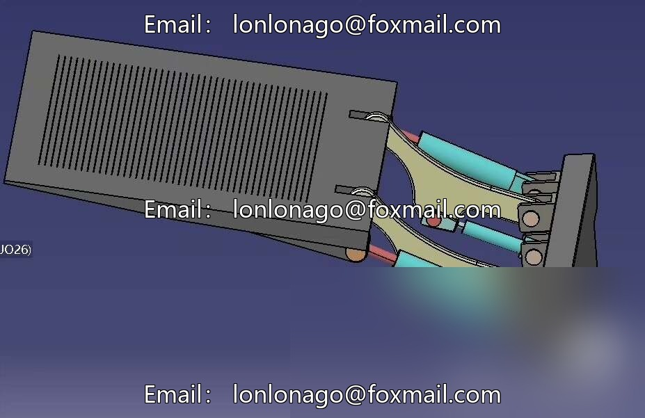

# Car gantry tailboard drawing, tailboard model number, tailboard 3D drawing, tailboard 3D, truck tailboard data

## Body

Car lift rear panel diagram, rear panel quantity model, rear panel 3D diagram, rear panel 3D, cargo truck rear panel data
Can be opened and edited with CATIA UG SolidWorks and other tools
There are other various 3D drawings for A008, specific details to be discussed further

The images show tail panel number models, three-dimensional tail panel figures and 3D tail panel data, with note that they can be opened and edited with Catia, UG SolidWorks and other tools; other 3D drawings are mentioned but details are not provided.

<!-- AI_ENRICHED -->

## Images

## Payment

Here is a pay link on Stripe ( https://buy.stripe.com/3cs8yP7sY87d0vu9AB ). Please contact me lonlonago@foxmail.com after funding $89, and I will send you a complete data files , thank you!

